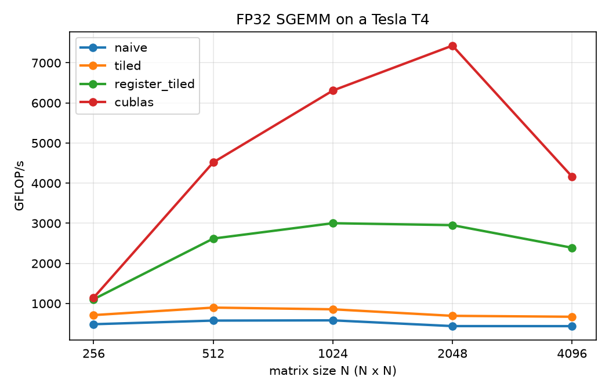

# Simulacrum

Simulacrum is a CUDA single precision matrix multiply (SGEMM, C = A × B) named after the simulacra in _Mother of Learning_, copies that work in parallel. Simply put, every element of C is a dot product of a row of A and a column of B, and the goal is to execute 2N³ of these operations as fasst as possible.

The intent is to understand how GPUs work and how to program them, and to see how matrix multiplication, the core of AI training, is optimized. It's fun, and I find the architecture of the hardware fascinating.

### Implemented

- **CPU reference** (`src/cpu_ref.cpp`) basic triple loop. Swapping the loop order from ijk to ikj improved 30x for N=1024 on my laptop (read cached lines of the B matrix)
- **Naive GPU kernel** (`src/sgemm_naive.cu`) one thread per element of C. threadIdx.x maps to the column so at each k a warp reads B and writes C in consecutive addresses. `sgemm_uncoalesced` is the opposite and was implemented to check the effect.
- **Shared memory tiling** (`src/sgemm_tiled.cu`) each 16x16 block loads tiles of A and B into shared memory and threads read from it, thereby reducing global reads.
- **Register tiling** (`src/sgemm_register_tiled.cu`)
  Similar to tiling,registers reuse shared memory reads within a thread. Each thread computes a 4x4 piece of C instead of one element, so each value it reads is used 4 times. Less overall threads and more work per each.
- **cuBLAS** (`src/sgemm_cublas.cu`) the reference used as ceiling to compare benchmarks.

### Benchmarks

Measured on a Tesla T4 (Google Colab), nvcc -O3 -arch=sm_75. GPU warmed up before timing, every number is the average of 10 runs after a warm up launch, and every kernel is checked against cuBLAS (max abs diff ≤ 2e-4). GFLOP/s = (2 × N³) / (seconds × 10⁹).

| N    | naive | tiled | register tiled | cuBLAS |
| ---- | ----- | ----- | -------------- | ------ |
| 256  | 483   | 711   | 1107           | 1146   |
| 512  | 574   | 898   | 2619           | 4519   |
| 1024 | 580   | 855   | 3002           | 6309   |
| 2048 | 437   | 692   | 2953           | 7430   |
| 4096 | 435   | 669   | 2390           | 4164   |



Tiling only gives ~1.5x over naive likely because naive kernel already benefits from the L1/L2 cache, and the tiled kernel now waits on shared memory (2 reads per multiply-add).

Register tiling fixes that and lands at ~40-58% of cuBLAS for N ≥ 512. At N=256 there are only 16 blocks of 64x64 for 40 SMs, so most of the GPU sits idle.

cuBLAS and register tiling both drop at N=4096 compared to 2048, repeated over 3 runs. I haven't measured why, my guess is the T4 hitting its power/clock limit on long runs.
The drop for N=4096 could be power/clock limit for the T4 on colab.

### Build

- NVIDIA GPU (tested on T4, sm_75)
- CUDA toolkit (tested with 13.0)
- Python 3 + matplotlib for the chart

```sh
# each version runs N = 256..1024 and checks against the CPU
nvcc -O3 -arch=sm_75 -o sgemm_tiled src/sgemm_tiled.cu && ./sgemm_tiled
nvcc -O3 -arch=sm_75 -o sgemm_cublas src/sgemm_cublas.cu -lcublas && ./sgemm_cublas

# benchmark all versions, writes results/bench.csv, then plot
mkdir -p results
nvcc -O3 -arch=sm_75 -o run_bench src/bench.cu -lcublas && ./run_bench
python3 scripts/plot.py
```
